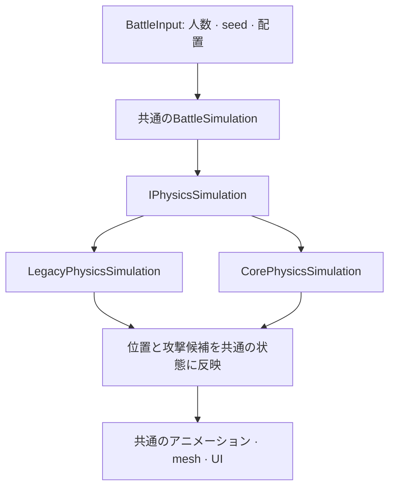

[English](README.md) · [日本語](README.ja.md) · [한국어](README.ko.md)

# Physics Comparison Lab


| 使用項目 | バージョン | 用途 |
|---|---|---|
| Unity | **6000.5.8f1（Unity 6.5）** | Editorでの実装・検証・測定 |
| PhysicsCore2D | **組み込みモジュール 1.0.0** | `Unity.U2D.Physics`による物理処理 |
| 従来のPhysics2D | 組み込みモジュール 1.0.0 | `Rigidbody2D`と`Collider2D`による比較用の実装 |
| 描画 | Built-in Render Pipeline | 戦場とキャラクターの描画 |
| Unity Collections | 6.5.0 | Coreの物理クエリ結果の処理 |
| Unity Test Framework | 1.7.0 | EditMode・PlayModeテスト |

PhysicsCore2Dの`1.0.0`は、Unity組み込みモジュールのバージョン表記です。このプロジェクトでは、**Unity 6000.5.8f1に含まれるAPI**を使っています。
[Unityのバージョン](ProjectSettings/ProjectVersion.txt) · [パッケージのバージョン](Packages/packages-lock.json)

---

## 試してみた理由

PhysicsCore2Dに興味を持ったのは、GameObjectやコンポーネントに縛られず、物理オブジェクトを直接扱える点でした。使い慣れたRigidbody2Dと何が違い、数千体のキャラクターがぶつかるゲームに役立つのか。それを確かめたくて、実際に戦闘を作って比較してみました。

このAPIは、Unityが2025年9月12日に紹介した、Box2D v3ベースのLow-level 2D Physicsから始まりました。当初はUnity 6.3ベータで利用でき、その後、2026年4月2日にUnity 6.5ベータ向けの名称としてPhysicsCore2Dが発表され、専用モジュールと`Unity.U2D.Physics`名前空間が用意されました。
[Unity 6.3での紹介](https://discussions.unity.com/t/low-level-2d-physics-in-unity-6-3/1683247) · [Physics Core 2Dの発表](https://discussions.unity.com/t/physics-core-2d-in-unity-6-5/1715178)

使用したのはUnity 6000.5.8f1です。接近して攻撃し、倒され、決着がつくまでの戦闘を両方の方式で実装しました。同じ戦闘を動かすことで、物理と表示のつなぎ方やオブジェクトの管理方法を比べながら、兵力を増やしたときの処理時間も測れるようにしました。

## 実験の構成

左のSoldierと右のOrcが互いに近づき、押し合いながら近距離で攻撃します。有効な攻撃を1回受けると死亡します。戦場全体を従来の`UnityEngine.Physics2D`か、新しい`Unity.U2D.Physics`のどちらかで動かし、切り替えると両陣営を含む戦闘全体の物理処理が入れ替わります。

人数は各陣営1〜2,500体、合計5,000体まで指定できます。兵力を増やしても戦場が収まるように、地面とカメラが自動で調整されます。

> 以下の処理時間は、すべてEditor内で測定したものです。


### 準備画面・従来のPhysics2D・戦闘終了

**準備 — 25対25**


**従来のPhysics2D — 250対250、120ステップで一時停止**


**Core — 25対25を実時間の1倍速で実行した結果**

seed 12345では280ステップ、シミュレーション時間で約4.67秒にSoldierが勝利しました。生存数はSoldierが4体、Orcが0体でした。


画面右側の統計は、現在の戦闘状態を確認するためのものです。一時停止中や終了後に残っているFPSや直前のStep時間は、戦闘中の性能を示しません。そのため、後述の比較では繰り返し測定した値を使っています。

## 実装方法

戦闘ルールと表示は共通にし、移動や衝突を処理する物理実装だけを交換できる構成にしました。Coreと従来のRigidbody2D／Collider2Dは別の物理システムに属し、互いに衝突しないため、一度に動かすのは戦場全体を受け持つ一方のシステムだけです。
[Unity 6000.5の公式説明](https://docs.unity.com/en-us/engine/6000.5/manual/unity2d/2d-physics-api/get-started/introduction)

戦闘状態はC#の配列で管理しており、DOTS/ECSは使っていません。共通の戦闘コードから`IPhysicsSimulation`を呼び出し、選択したエンジンで物理を進め、その位置を共通の表示コードに渡します。



### 物理ワールドの生成と解放

Coreでは、[CorePhysicsSimulation](Assets/PhysicsComparisonLab/Scripts/Physics/Core/CorePhysicsSimulation.cs)で`PhysicsWorld`を直接生成します。重力は0にし、シミュレーションを進めるタイミングはコードで制御します。生成したworldとbodyの所有キーを保持し、死亡時や戦闘の再開始時に解放します。Unityのデフォルトworldは破棄しません。

```csharp
var definition = PhysicsWorldDefinition.defaultDefinition;
definition.gravity = Vector2.zero;
definition.simulationType = PhysicsWorld.SimulationType.Script;
definition.drawOptions = PhysicsWorld.DrawOptions.Off;

_world = PhysicsWorld.Create(definition);
_key = _world.SetOwner(null);
```

ユニットには円形shapeを持つ`Dynamic` bodyを、戦場の境界4辺には`Static` bodyを使いました。回転を固定し、摩擦・反発・減衰は0にしています。半径0.12、密度`1 / (πr²)`で質量を1に揃え、従来の実装でも質量1のRigidbody2DとCircleCollider2Dを使いました。

### 同じ時間間隔で物理を進める

両方とも、1ステップで進めるシミュレーション時間は**1/60秒**です。共通の戦闘コードから移動速度を設定し、選択したエンジンを一度進めて結果を読み戻します。流れは同じですが、呼び出すAPIは異なります。

| 処理 | 従来のPhysics2D | PhysicsCore2D |
|---|---|---|
| 速度の設定 | Rigidbody2Dの速度 | PhysicsBodyの`linearVelocity` |
| 物理を進める | `Physics2D.Simulate(seconds)` | `PhysicsWorld.Simulate(seconds)` |
| 位置の取得 | Rigidbody2Dの位置 | PhysicsBodyの位置 |
| 攻撃範囲の照会 | `Physics2D.OverlapCircle` | `PhysicsWorld.OverlapGeometry` |
| 死亡・終了時 | 物理の無効化、GameObjectの解放、グローバルな実行モードの復元 | 所有キーでbody・worldを破棄 |

コードから明示的に進めるため、自動シミュレーションと手動実行が重複しないように設定しています。従来の実装では終了時にグローバルな実行モードを元に戻し、エンジンを切り替えるときは、前の物理オブジェクトを解放してから次を生成します。

クエリ結果の扱いも異なります。Coreでは`Allocator.Temp`で受け取った配列を`finally`で解放します。従来の実装では全ユニットを収められる結果バッファを事前に確保し、あふれていないか確認します。Coreの結果配列を生成・解放する時間も測定に含めています。

### 共通の戦闘ルールと表示

`BattleInput`に初期位置、陣営、ID、出発までの待ち時間をまとめ、両方に同じ開始条件を渡します。比較時のseedは12345で、攻撃ルールも共通です。攻撃開始をステップAとすると、**A+18で命中を判定**し、**A+36から次の攻撃が可能**になります。

攻撃中は標的を固定します。命中するステップで実際の攻撃範囲を照会し、距離も再確認します。同じステップの命中候補を集めてから死亡をまとめて反映するため、相打ちも発生します。決着がつかない場合は1,800ステップ、シミュレーション時間で30秒を上限に終了します。

得られた位置とアニメーションフレームは共通のmeshに反映します。表示用のGameObjectやAnimatorはユニットごとに作りませんが、従来の実装には物理処理用のGameObjectがあります。ルールと表示を共通にしても、接触の処理が違えば軌跡や命中、勝者は変わります。両システム間で同じ結果や決定論的な再現を保証するものではありません。

## 機能検証の結果

ルールどおりに戦闘が進むこと、一時停止中に位置が変わらないこと、再開始時に前の物理オブジェクトが残らないことを確認しました。現在のコードは**EditMode 25/25件、PlayMode 5/5件**のテストに合格しています。実際の物理動作と操作について確認した範囲は次のとおりです。
[テスト結果](Documentation/test-results.json) · [検証記録](Documentation/Validation.ja.md)

| 項目 | 確認内容 |
|---|---|
| 戦闘ルール | A+18の命中、A+36の再攻撃、相打ち、重複命中、標的の固定、制限時間 |
| 物理 | 両APIによる移動・接触・攻撃範囲の照会、body・worldの解放 |
| 戦闘終了 | 両システムで1:1、1:2、25:25、100:100、250:250が終了まで進むこと |
| セッション操作 | 停止中の位置維持、正確な1ステップ実行、再開始、10回の切り替え、イベントの重複防止 |
| 入力・UI | 不正入力の拒否、人数追加と上限、1倍速・2倍速、右パネルの生存数 |
| 大規模な戦闘 | 両システムで1,500:1,500を120ステップ実行し、移動・命中・死亡・解放・カメラの縮小を確認 |
| 最大人数 | Coreで2,500:2,500の通常戦闘を120ステップ実行。別途、両システムで5,000体の固定負荷を720ステップずつ繰り返し測定 |

最大人数での検証は条件を分けています。5,000体の通常戦闘を120ステップまで確認したのはCoreです。両エンジンの繰り返し測定では、人数を一定に保つため死亡を無効にしました。


この場面では5,000体で開始し、120ステップ時点で4,872体が生存していました。表示されている約677 FPSは、撮影のために**一時停止した状態**の値です。

## 性能比較

戦闘が動くことを確認してから人数を増やし、処理時間を比べました。通常の戦闘では、エンジンによって死亡のタイミングと生存数が変わり、処理量も変わります。そこで速度の比較には人数を維持する固定負荷を使い、通常戦闘の結果も[統計表](Documentation/Benchmarks/2026-10-28/tables.ja.md)と[実行ごとのCSV](Documentation/Benchmarks/2026-10-28/runs.csv)に残しました。

このシーンでは25対25は従来のPhysics2Dが速く、100対100以上の固定負荷ではCoreの処理時間が短くなりました。差がどこで生じるかを見るために、物理シミュレーションと戦闘ステップ全体を分けて測っています。フレーム全体のFPSを比べたものではありません。

### 測定条件

| 項目 | 条件 |
|---|---|
| 機器・OS | Windows 11、Ryzen 7 7800X3D、論理プロセッサ16基、RAM約64 GB、RTX 5070 Ti、Direct3D12 |
| 実行環境 | Unity 6000.5.8f1 Editor、Built-in、Mono、1920×1080、VSync 0、フレーム制限なし、Profiler記録オフ |
| 共通入力 | seed 12345、dt 1/60秒、一度に一方の物理システムを実行し、繰り返しごとにLegacy→Core／Core→Legacyを交互に使用 |
| 固定負荷 | 各陣営25/100/250/1,500/2,500体、死亡なし、120ステップの準備後に600ステップを測定 |
| 通常戦闘 | 各陣営25/100/250体、最初のステップから決着または1,800ステップまで、死亡あり |
| 表示更新 | 表示更新なしと共通mesh更新ありの両方を測定 |
| 繰り返し | 各組み合わせ5回、**計160回・測定対象90,579ステップ** |

UIと自動カメラ更新は停止し、実時間の経過を待たず、描画1フレームにつき最大8ステップを処理しました。以下はステップの関数呼び出しから戻るまでの時間で、GPU描画を含むフレーム全体の時間ではありません。[測定方法の詳細](Documentation/Benchmarks/README.ja.md)

### 固定負荷・表示更新なし

まず、表示更新を除き、物理シミュレーションと戦闘ステップ全体を比べました。戦闘ステップには物理、共通ロジック、攻撃範囲の照会、位置の読み戻しが含まれます。単位は1ステップあたりのミリ秒（ms）で、小さいほど高速です。各実行の600標本から中央値を求め、その5回分の中央値を表にしています。

| 人数 | 従来の物理 | Coreの物理 | 従来の戦闘ステップ | Coreの戦闘ステップ |
|---:|---:|---:|---:|---:|
| 25 + 25 | 0.0359 | 0.0405 | 0.0466 | 0.0555 |
| 100 + 100 | 0.3015 | 0.1288 | 0.3548 | 0.1878 |
| 250 + 250 | 0.9702 | 0.2466 | 1.1102 | 0.3866 |
| 1,500 + 1,500 | 7.1841 | 0.8130 | 8.1589 | 1.5914 |
| 2,500 + 2,500 | 13.4339 | 1.2275 | 14.9513 | 2.5273 |


グラフの縦軸は対数目盛です。エラーバーは5回の中央値の最小値と最大値で、信頼区間ではありません。5,000体では、Coreの物理処理時間は従来の約**1/10.94**、表示を除く戦闘ステップは約**1/5.92**でした。

ただし、小規模でも同じ傾向になるわけではありません。50体ではCoreの物理計算が**0.0046 ms**、約13%長くかかりました。これらの比率は、このシーンと設定に限った結果です。

### 表示更新のコストと遅いステップ

物理が速くなっても、その結果を画面に反映する処理は残ります。同じ最大人数で共通meshの更新を含め、普段の処理時間だけでなく、遅いステップも確認しました。

| 2,500 + 2,500、mesh更新を含む | 従来のPhysics2D | PhysicsCore2D |
|---|---:|---:|
| 物理 p50 | 13.4643 ms | 1.2782 ms |
| 全体 p50 | 16.4155 ms | 4.0000 ms |
| 全体 p95 | 35.5988 ms | 21.2994 ms |

p50は中央値、p95は標本を速い順に並べたときの95%地点の値です。表には各実行で求めた統計値5個の中央値を載せています。全体の処理時間は短くなりましたが、**Coreのp95も21.30 msで、60 FPSの1フレームに使える16.67 msを超えています。** 遅いステップは残っており、安定した60 FPSを示す結果ではありません。


このグラフは処理区間ごとの平均時間を示しています。中央値を使う表とは集計方法が異なりますが、Coreでは物理シミュレーションそのものより、敵探索などの共通ロジックやmesh更新に時間がかかっていることが分かります。

### 結果を適用できる範囲

物理設定はCoreがsubsteps 4・workers 16、従来方式がvelocity iterations 8・position iterations 3・Discreteです。ソルバーの精度や連続衝突判定の条件を同等に揃えた比較ではありません。固定負荷は人数の減少を防ぎますが、軌跡や接触の分布まで一致させるものではなく、今回は1つのseedと配置で測っています。

経過時間にはOSのスケジューリングやEditor環境の影響も含まれます。workerスレッドのCPU使用時間を合算した値ではありません。独立したPlayerの性能、メモリ、GC、GPU、消費電力、他プラットフォームは測定しておらず、画面のカウンターからそれらを判断することもしていません。

---

## 試して分かったこと

**今回の条件では、人数の多い戦闘ほどCoreの効果が大きくなりました。** 5,000体の固定負荷では、物理処理が従来の13.43 msからCoreの1.23 msに短縮されました。多くのユニットが密集して衝突するゲームで、物理処理の負担を減らす候補になりそうです。一方、50体では従来方式がわずかに速く、Coreにも遅いステップが残ったため、安定した60 FPSを確認できたわけではありません。

使っていてよかったのは、物理オブジェクトと表示用GameObjectを分けやすい点です。world・body・shapeの生成と解放を自分で管理する必要はありますが、その分、物理と表示を分離した構成を実際の戦闘に使えました。

Coreに切り替えても、敵探索や表示更新のコストは残ります。ゲームへの導入を考えるなら、まず物理が実際にボトルネックになっているかを確認するのがよさそうです。

## コード案内

| ファイル | 役割 |
|---|---|
| [BattleSettings](Assets/PhysicsComparisonLab/Scripts/Battle/BattleSettings.cs) / [BattleInput](Assets/PhysicsComparisonLab/Scripts/Battle/BattleInput.cs) | 共通設定とseedに基づく初期配置 |
| [BattleSimulation](Assets/PhysicsComparisonLab/Scripts/Battle/BattleSimulation.cs) | 判断 → 物理実行 → 位置取得 → 攻撃判定 → 死亡の一括反映 |
| [IPhysicsSimulation](Assets/PhysicsComparisonLab/Scripts/Physics/IPhysicsSimulation.cs) | 2つの物理実装に共通するインターフェース |
| [LegacyPhysicsSimulation](Assets/PhysicsComparisonLab/Scripts/Physics/Legacy/LegacyPhysicsSimulation.cs) | 従来のコンポーネントの生成・実行・照会・解放 |
| [CorePhysicsSimulation](Assets/PhysicsComparisonLab/Scripts/Physics/Core/CorePhysicsSimulation.cs) | world・body・shapeの生成、所有キー、クエリ結果の解放 |
| [BattleTargetIndex](Assets/PhysicsComparisonLab/Scripts/Battle/BattleTargetIndex.cs) | 最も近い敵の探索と同距離の候補の選択 |
| [BattleWorldView](Assets/PhysicsComparisonLab/Scripts/Presentation/BattleWorldView.cs) | 位置とアニメーションフレームを共通meshに反映 |
| [BattleComparisonEntryPoint](Assets/PhysicsComparisonLab/Scripts/Presentation/BattleComparisonEntryPoint.cs) | セッション制御と資源の解放 |
| [Tests](Assets/PhysicsComparisonLab/Tests/) | 共通ルールと実際のシーンを使うテスト |

## アセットの出典と利用条件

以下の無料アセットを使用しました。

| 用途 | 作者・アセット | 使用内容 |
|---|---|---|
| キャラクター | **Zerie** — [Tiny RPG Character Asset Pack](https://zerie.itch.io/tiny-rpg-character-asset-pack) | 無料版Soldier・Orcの待機、移動、攻撃、死亡アニメーション |
| 地形・装飾・UI | **Pixel Frog** — [Tiny Swords](https://pixelfrog-assets.itch.io/tiny-swords) | 無料版の草地、木、茂み、岩、ボタン、紙のパネル |

どちらも作者独自の利用規約で、個人・商用ゲームでの利用と改変は認められていますが、元のアセットや改変したアセットの再配布は禁止されています。**そのため、アセットファイルはこのリポジトリに含めていません。**（2026-10-28に配布ページの規約を確認）

性能グラフは**hakrimryu**が作成しました。引用の際は出典表記を残してください。

## 測定資料と参考文献

- [測定方法](Documentation/Benchmarks/README.ja.md) · [元のCSVと実際の設定](Documentation/Benchmarks/2026-10-28/) · [検証記録](Documentation/Validation.ja.md)
- [分析・グラフ作成コード](Documentation/Benchmarks/analyze.py) · [Editor測定コード](Documentation/Benchmarks/EditorComparison.cs)
- [撮影時の状態とハッシュ](Documentation/screenshots.json) · [測定時のソースSHA256](Documentation/Benchmarks/2026-10-28/source-sha256.json)
- [Unity 6.5 Physics Core 2D公式ドキュメント](https://docs.unity.com/en-us/engine/6000.5/manual/unity2d/2d-physics-api/get-started/introduction)
