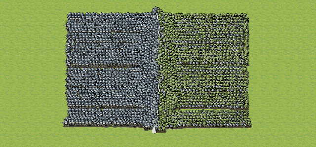
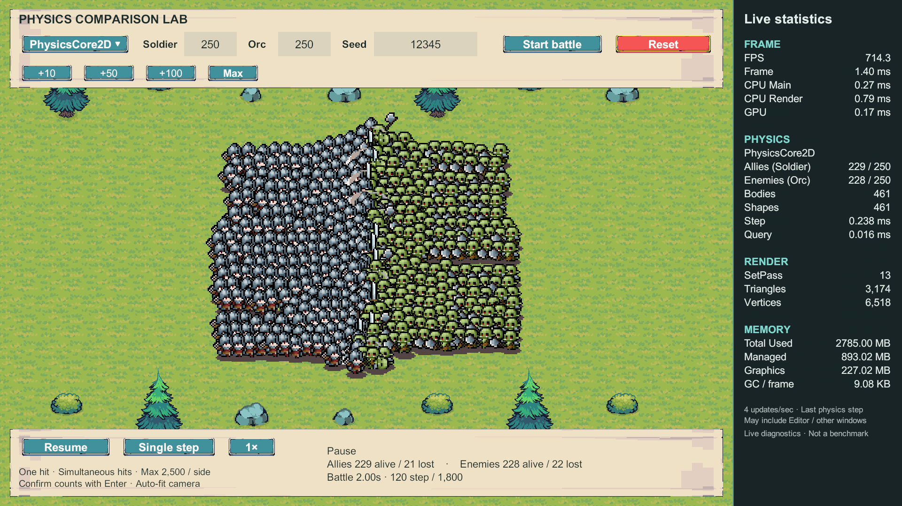
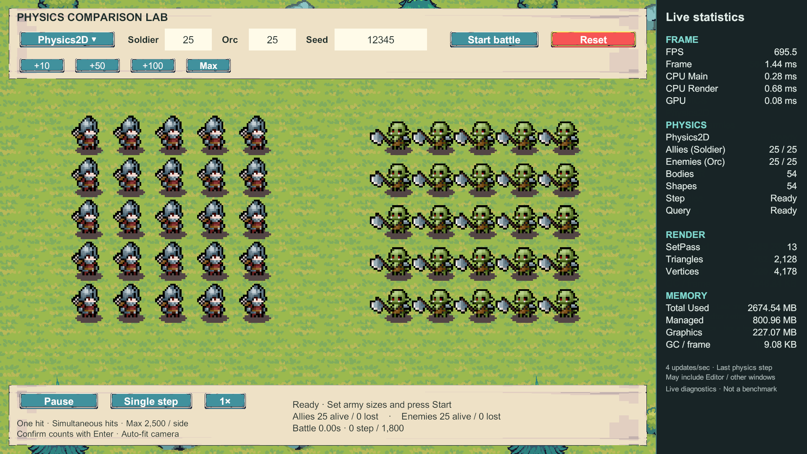
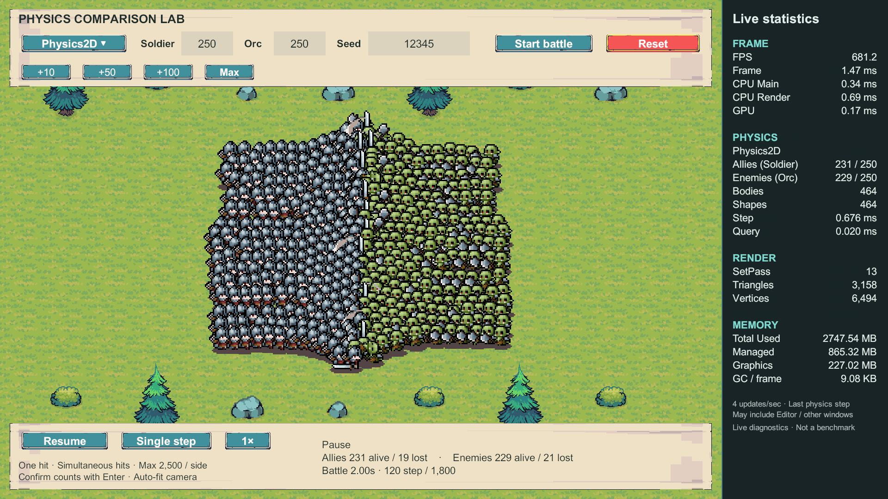
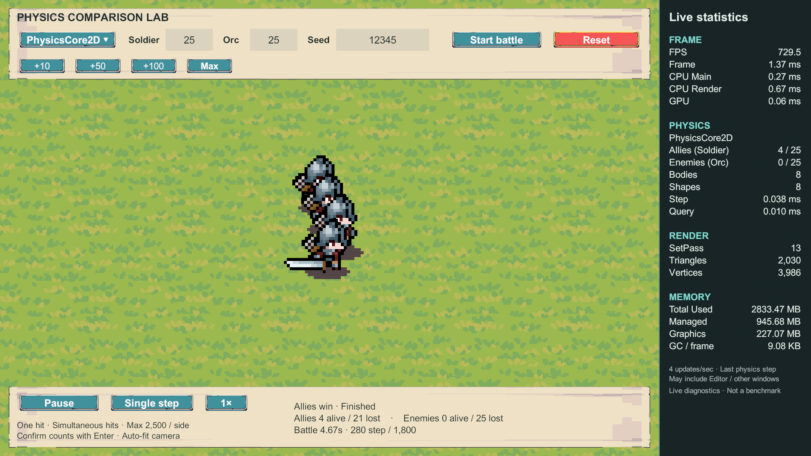
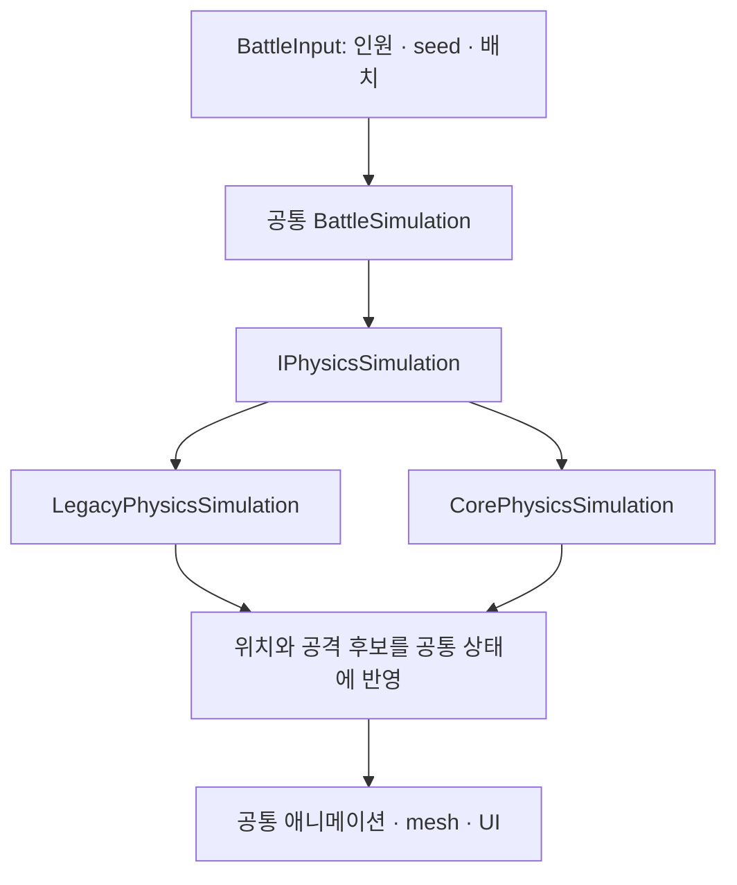
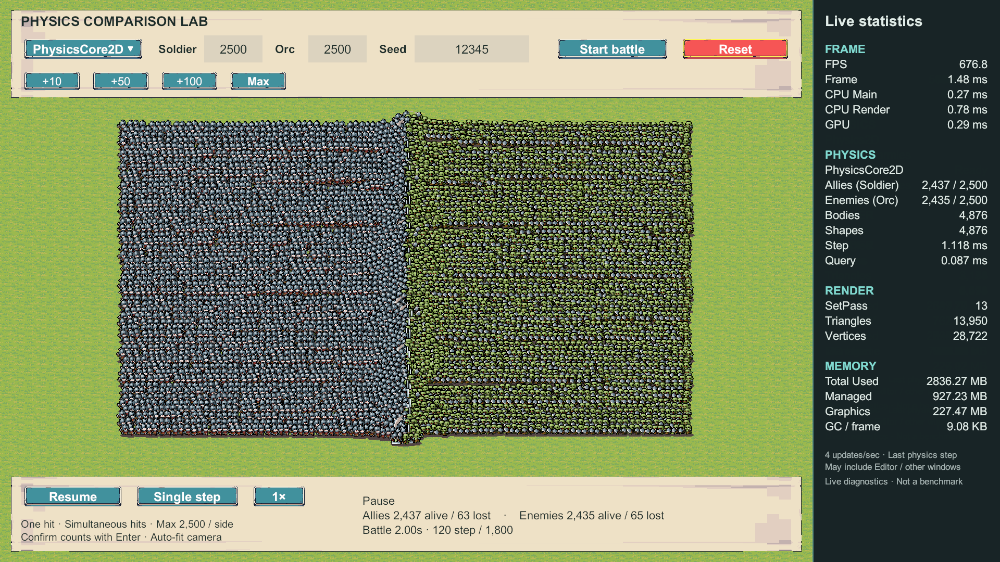
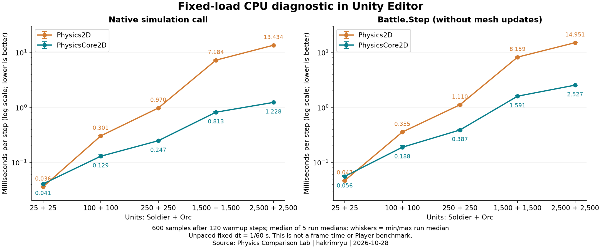
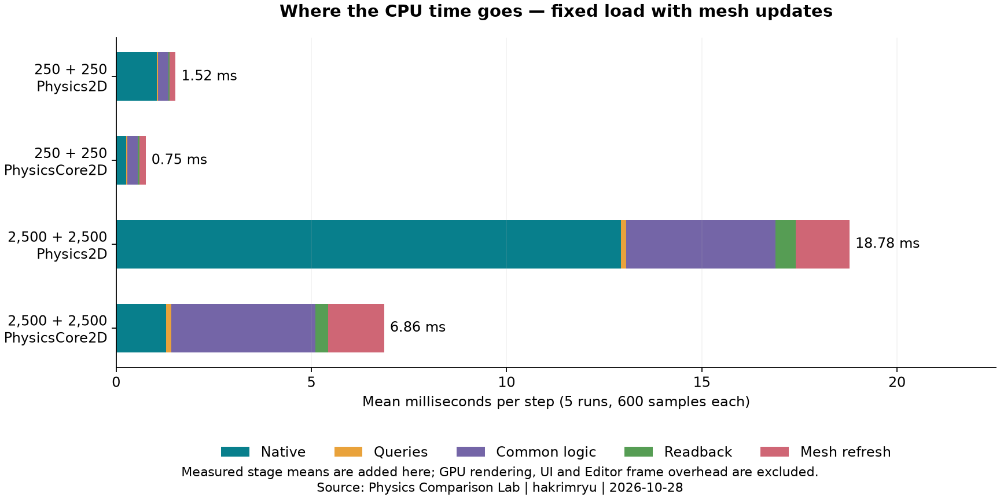

[English](README.md) · [日本語](README.ja.md) · [한국어](README.ko.md)

# Physics Comparison Lab



| 사용 항목 | 버전 | 용도 |
|---|---|---|
| Unity | **6000.5.8f1 (Unity 6.5)** | Editor에서 구현·검증·측정 |
| PhysicsCore2D | **내장 모듈 1.0.0** | `Unity.U2D.Physics` 기반 물리 구현 |
| 기존 Physics2D | 내장 모듈 1.0.0 | `Rigidbody2D`·`Collider2D` 비교 구현 |
| 렌더링 | Built-in Render Pipeline | 전장과 캐릭터 표시 |
| Unity Collections | 6.5.0 | Core 물리 조회 결과 처리 |
| Unity Test Framework | 1.7.0 | EditMode·PlayMode 테스트 |

PhysicsCore2D의 `1.0.0`은 Unity 내장 모듈의 버전 표기이며, 이 프로젝트의 실제 API 기준은 **Unity 6000.5.8f1**입니다.
[Unity 버전](ProjectSettings/ProjectVersion.txt) · [패키지 버전](Packages/packages-lock.json)

---
## 시작한 이유

PhysicsCore2D가 GameObject나 컴포넌트에 종속되지 않고 물리 객체를 직접 다룰 수 있다는 점에 관심이 갔습니다. “기존 Rigidbody2D 방식과 무엇이 다르고, 수천 캐릭터가 부딪히는 게임에 도움이 될까?”라는 궁금증이 생겼고 실제 전투를 만들어 차이를 확인해 보기로 했습니다.

이 API는 Unity가 2025년 9월 12일에 소개한 Box2D v3 기반의 Low-level 2D Physics에서 시작했습니다. 당시에는 Unity 6.3 베타에서 사용할 수 있었고 이후 2026년 4월 2일에는 Unity 6.5 베타에서 PhysicsCore2D라는 이름과 전용 모듈, `Unity.U2D.Physics` 네임스페이스를 제공한다고 발표했습니다.
[Unity 6.3 공식 소개](https://discussions.unity.com/t/low-level-2d-physics-in-unity-6-3/1683247) · [Physics Core 2D 공식 발표](https://discussions.unity.com/t/physics-core-2d-in-unity-6-5/1715178)

이번에는 Unity 6000.5.8f1에서 캐릭터들이 서로 접근해 싸우고 승패가 결정되는 작은 전투를 두 방식으로 구현했습니다. 같은 전투를 만드는 과정에서 물리 객체를 관리하고 화면에 표시하는 방법을 비교하고 병력을 늘렸을 때 처리 시간이 얼마나 달라지는지도 살펴봤습니다.

## 실험 구성

전투는 왼쪽의 Soldier와 오른쪽의 Orc가 서로 접근해 밀리면서 근접 공격을 하는 방식으로 만들었습니다. 한 번 유효하게 맞으면 사망하는 규칙을 두고 두 진영을 포함한 전장 전체를 기존 `UnityEngine.Physics2D`와 새로운 `Unity.U2D.Physics`로 각각 실행했습니다. 비교할 때는 전장 전체를 처리하는 물리 엔진을 전환합니다.

인원은 진영별 1~2,500명, 합계 최대 5,000명까지 바꿀 수 있도록 했습니다. 병력을 늘려도 전장을 한눈에 볼 수 있게 카메라와 지면도 규모에 맞춰 자동 조정됩니다.

> 아래 수치는 Editor 안에서 측정한 처리 시간입니다.



### 준비·기존 Physics2D·전투 종료 화면

**준비 - 25 대 25**



**기존 Physics2D - 250 대 250, 120스텝에서 일시정지**



**Core - 25 대 25를 실제 1배속으로 실행한 결과**

seed 12345로 실행한 전투는 280스텝, 시뮬레이션 시간 약 4.67초에 Soldier 4명과 Orc 0명이 남으면서 Soldier의 승리로 끝났습니다.



화면 오른쪽의 실시간 통계로 전투가 진행되는 상태를 확인할 수 있습니다. 다만 정지·종료 화면에 남아 있는 FPS와 마지막 Step 시간은 실행 중 성능을 대표하지 않으므로 성능 비교에는 아래의 반복 측정 결과를 사용했습니다.

## 구현 방법

전투 규칙과 표시 코드는 공통으로 두고 이동과 충돌을 처리하는 물리 구현만 바꿀 수 있도록 구성했습니다. Core와 기존 Rigidbody2D·Collider2D는 서로 다른 물리 시스템이라 직접 충돌하지 않으므로 한 번에 한 방식으로 전투 전체를 실행합니다.
[Unity 6000.5 공식 소개](https://docs.unity.com/en-us/engine/6000.5/manual/unity2d/2d-physics-api/get-started/introduction)

이때 전투 상태는 DOTS/ECS 없이 C# 배열로 관리했습니다. 공통 전투 코드가 `IPhysicsSimulation`을 호출하면 선택한 엔진이 물리를 계산하고 그 위치를 공통 표시 코드에 넘겨 화면을 갱신하는 구조입니다.



### 물리 세계 생성과 해제

Core 쪽은 아래의 [CorePhysicsSimulation](Assets/PhysicsComparisonLab/Scripts/Physics/Core/CorePhysicsSimulation.cs) 코드처럼 `PhysicsWorld`를 직접 만드는 데서 시작합니다. 중력은 0으로 설정하고 물리가 진행되는 시간은 코드에서 지정하도록 했습니다. 생성한 world와 body의 소유 키를 보관해 사망하거나 전투를 재시작할 때 해당 객체를 해제하며 Unity의 기본 world는 유지합니다.

```csharp
var definition = PhysicsWorldDefinition.defaultDefinition;
definition.gravity = Vector2.zero;
definition.simulationType = PhysicsWorld.SimulationType.Script;
definition.drawOptions = PhysicsWorld.DrawOptions.Off;

_world = PhysicsWorld.Create(definition);
_key = _world.SetOwner(null);
```

이 world 안에 유닛을 `Dynamic` body와 원형 shape로 만들고 전장 경계 네 개는 `Static` body로 배치했습니다. 회전을 잠그고 마찰·반발·감쇠를 0으로 둔 상태에서 원의 반지름을 0.12, 밀도를 `1 / (πr²)`로 지정해 질량을 1에 맞췄습니다.
기존 방식에서도 질량 1의 Rigidbody2D와 CircleCollider2D를 사용했습니다.

### 같은 시간 간격으로 실제 물리 처리

물리 객체를 만든 뒤에는 두 방식 모두 시뮬레이션 시간 **1/60초**를 한 스텝으로 처리합니다.
매 스텝마다 공통 전투 코드가 이동 속도를 정하고 선택한 엔진을 한 번 진행한 뒤 결과를 읽습니다. 이 흐름은 같고 실제로 호출하는 API가 아래처럼 다릅니다.

| 처리 | 기존 Physics2D | PhysicsCore2D |
|---|---|---|
| 속도 적용 | Rigidbody2D의 속도 | PhysicsBody의 `linearVelocity` |
| 물리 진행 | `Physics2D.Simulate(seconds)` | `PhysicsWorld.Simulate(seconds)` |
| 위치 읽기 | Rigidbody2D 위치 | PhysicsBody 위치 |
| 공격 범위 조회 | `Physics2D.OverlapCircle` | `PhysicsWorld.OverlapGeometry` |
| 사망·종료 | 물리 비활성화·GameObject 해제, 전역 모드 복구 | 소유 body/world를 키로 파괴 |

이처럼 코드에서 직접 물리를 진행하므로 자동 실행과 수동 실행이 겹치지 않게 설정했습니다.
기존 방식에서 바꾼 전역 simulation mode는 종료할 때 복구하고 엔진을 전환할 때는 이전 물리 객체를 해제한 다음 새 객체를 생성합니다.

공격 범위를 조회한 뒤의 정리 방식에도 차이가 있습니다. Core에서는 `Allocator.Temp`로 받은 배열을 `finally`에서 해제하고 기존 방식에서는 전체 유닛 수만큼 준비한 결과 버퍼를 사용하면서 넘침을 검사합니다. Core의 배열 생성과 해제 비용도 측정에 포함했습니다.

### 공통 전투 규칙과 표시

물리 구현이 달라도 같은 조건에서 전투를 시작하도록 `BattleInput`으로 초기 위치, 팀, ID, 출발 지연을 전달했습니다. 비교에 사용한 seed는 12345이며 공격 규칙도 두 방식이 공유합니다. 공격 시작 스텝을 A라고 하면 **A+18에 명중을 판정**하고 **A+36부터 다시 공격**합니다.

공격 도중에는 표적을 바꾸지 않고 명중 시점에 실제 공격 범위 조회와 거리 조건을 다시 확인합니다. 같은 스텝에 나온 명중 후보를 모두 모은 뒤 사망을 한꺼번에 적용하므로 서로 동시에 쓰러질 수 있습니다. 승패가 나지 않은 전투는 1,800스텝, 시뮬레이션 시간 30초에 종료합니다.

계산이 끝난 위치와 애니메이션 프레임은 공통 mesh에 반영합니다. 유닛마다 표시용 GameObject나 Animator를 만들지 않았으며 기존 방식에서 사용하는 물리용 GameObject만 별도로 존재합니다. 전투 규칙과 표시를 공유하더라도 엔진마다 접촉을 처리하는 방식이 달라 궤적·명중·승자가 달라질 수 있습니다. 두 방식이 동일한 결과를 내거나 결정론적으로 재생되는 것은 보장하지 않습니다.

## 기능 검증 결과

구현한 전투가 규칙대로 진행되는지, 정지 중에는 위치가 유지되는지, 재시작할 때 이전 물리 객체가 정리되는지 확인했습니다. 현재 코드는 **EditMode 25/25, PlayMode 5/5** 테스트를 통과했으며 실제 엔진을 사용한 전투와 조작도 아래 범위에서 검증했습니다.
[테스트별 결과](Documentation/test-results.json) · [검증 기록](Documentation/Validation.md)

| 검증 | 확인한 내용 |
|---|---|
| 전투 규칙 | A+18 명중, A+36 재공격, 동시 사망, 중복 명중, 표적 고정, 시간제한 |
| 실제 물리 | 양쪽 API의 이동·접촉·공격 범위 조회, body/world 해제 |
| 전투 종료 | 1:1, 1:2, 25:25, 100:100, 250:250을 두 방식으로 종료까지 실행 |
| 세션 조작 | 정지 중 위치 고정, 정확한 한 스텝, 재시작, 10회 전환, 이벤트 중복 방지 |
| 입력·UI | 잘못된 값 거부, 증원·상한, 1×/2×, 우측 패널의 실제 생존 수 |
| 대규모 기능 | 양쪽 1,500:1,500의 120스텝 이동·명중·사망·해제·카메라 축소 |
| 최대 인원 | Core 2,500:2,500 일반 전투 120스텝. 별도로 양쪽 5,000유닛 고정 부하 720스텝 반복 |

최대 인원에서는 검증 범위를 나누었습니다. 5,000유닛이 싸우는 일반 전투는 Core에서 120스텝까지 확인했고 양쪽 엔진을 반복 측정할 때는 사망을 꺼서 인원을 유지하는 고정 부하 조건을 사용했습니다.



위 화면은 5,000명으로 시작한 전투에서 120스텝 뒤 4,872명이 남은 모습입니다. 촬영을 위해 멈춘 상태라 화면의 약 677 FPS는 **일시정지 중 값**입니다.

## 성능 비교

전투가 동작하는 것을 확인한 뒤에는 인원을 늘려 가며 처리 시간을 비교했습니다. 일반 전투에서는 엔진별 사망 시점과 남은 병력이 달라 부하도 달라지므로 속도 비교에는 인원을 유지하는 고정 부하 결과를 사용했습니다. 일반 전투의 결과도 [전체 통계표](Documentation/Benchmarks/2026-10-28/tables.md)와 [실행별 CSV](Documentation/Benchmarks/2026-10-28/runs.csv)에 남겼습니다.

이번 장면에서는 25 대 25일 때 기존 방식이 빨랐고 100 대 100 이상 고정 부하에서는 Core의 처리 시간이 짧았습니다. 이 차이가 어디에서 생기는지 보기 위해 물리 계산과 전투 처리 전체를 나눠 측정했으며 프레임 전체의 FPS는 비교하지 않았습니다.

### 측정 조건

| 항목 | 조건 |
|---|---|
| 환경 | Windows 11, Ryzen 7 7800X3D, 논리 프로세서 16개, RAM 약 64 GB, RTX 5070 Ti, Direct3D12 |
| 실행 | Unity 6000.5.8f1 Editor, Built-in, Mono, 1920×1080, VSync 0, 프레임 상한 해제, Profiler 기록 끔 |
| 공통 입력 | seed 12345, dt 1/60초, 한 번에 한 물리 방식, 반복별 Legacy→Core / Core→Legacy 교대 |
| 고정 부하 | 진영별 25/100/250/1,500/2,500, 사망 끄기, 120스텝 준비 후 600스텝 수집 |
| 일반 전투 | 진영별 25/100/250, 첫 스텝부터 결과 또는 1,800스텝까지, 사망 허용 |
| 표시 조건 | 표시 갱신 제외 / 공통 mesh 갱신 포함을 각각 측정 |
| 반복 | 각 조합 5회, **총 160회·90,579개 측정 스텝** |

측정 중에는 UI·자동 카메라를 끄고 프레임당 최대 8스텝을 기다림 없이 처리했습니다. 아래 시간은 한 스텝의 함수를 실행하고 돌아올 때까지 걸린 값이며 GPU 렌더링 등을 포함한 프레임 전체 시간은 아닙니다. [상세 측정 방법](Documentation/Benchmarks/README.md)

### 고정 부하, 표시 갱신 제외

먼저 화면 표시를 제외하고 물리 계산에 드는 시간과 전투 처리에 드는 시간을 비교했습니다. 여기서 전투 처리는 물리 계산에 공통 로직, 공격 조회, 위치 읽기까지 포함한 범위입니다. 단위는 한 스텝당 밀리초(ms)로 작을수록 좋으며 각 실행의 600개 표본에서 중앙값을 구한 다음 그 값 5개의 중앙값을 표에 적었습니다.

| 병력 | 기존 물리 계산 | Core 물리 계산 | 기존 전투 처리 | Core 전투 처리 |
|---:|---:|---:|---:|---:|
| 25 + 25 | 0.0359 | 0.0405 | 0.0466 | 0.0555 |
| 100 + 100 | 0.3015 | 0.1288 | 0.3548 | 0.1878 |
| 250 + 250 | 0.9702 | 0.2466 | 1.1102 | 0.3866 |
| 1,500 + 1,500 | 7.1841 | 0.8130 | 8.1589 | 1.5914 |
| 2,500 + 2,500 | 13.4339 | 1.2275 | 14.9513 | 2.5273 |



그래프의 세로축은 로그 눈금이며 오차 막대는 신뢰구간이 아니라 5회 실행 중앙값의 최솟값~최댓값을 나타냅니다. 5,000유닛에서는 Core의 물리 계산 시간이 기존 방식의 약 **1/10.94**로 줄었고 표시를 제외한 전투 처리 시간도 약 **1/5.92**였습니다.

이 차이가 작은 전투에서도 그대로 나타나지는 않았습니다. 50유닛에서는 오히려 Core의 물리 계산이 **0.0046 ms**, 약 13% 더 오래 걸렸습니다. 위 비율은 표에 적힌 장면과 설정에서 얻은 결과입니다.

### 표시 갱신 비용과 느린 스텝

물리 계산이 빨라져도 그 결과를 화면에 반영하는 작업은 남습니다. 같은 최대 인원에서 공통 mesh 갱신까지 포함해 측정하고 보통의 처리 시간뿐 아니라 느리게 처리된 스텝도 함께 확인했습니다.

| 2,500 + 2,500, mesh 갱신 포함 | 기존 Physics2D | PhysicsCore2D |
|---|---:|---:|
| 물리 계산 p50 | 13.4643 ms | 1.2782 ms |
| 전체 처리 p50 | 16.4155 ms | 4.0000 ms |
| 전체 처리 p95 | 35.5988 ms | 21.2994 ms |

표의 p50은 중앙값이고 p95는 표본을 빠른 순서로 정렬했을 때 95% 지점의 값으로, 5회 실행에서 구한 p50·p95를 각각 중앙값으로 정리했습니다. 전체 처리 시간은 줄었지만 **Core의 p95도 21.30 ms로, 60 FPS에서 한 프레임에 쓸 수 있는 16.67 ms를 넘었습니다.** 이렇게 느린 스텝이 남아 있어 안정적 60 FPS를 확인한 결과로 볼 수는 없습니다.



구간별 평균 시간을 그린 위 그래프에서는 어떤 작업에 시간이 드는지 볼 수 있습니다. 앞 표의 중앙값과 집계 방식은 다르지만 Core에서는 물리 계산보다 적 탐색 등 공통 로직과 mesh 갱신에 더 많은 시간이 들었다는 점을 확인했습니다.

### 결과가 적용되는 범위

비교에 사용한 물리 설정은 Core가 substeps 4·workers 16, 기존 방식이 velocity iterations 8·position iterations 3·Discrete로 달랐으며 계산 정확도와 연속 충돌 조건을 동등하게 맞추지는 않았습니다. 고정 부하로 인원 감소는 막았지만 궤적과 접촉 분포까지 같게 만들지는 않았으므로 한 seed와 이 배치에서 얻은 결과입니다.

측정 시간에는 운영체제 스케줄링과 Editor 환경의 영향이 포함됩니다. CPU 작업 스레드의 사용시간을 모두 더한 값은 아니며 별도 Player 실행이나 메모리·GC·GPU·전력·다른 플랫폼의 성능도 측정하지 않았습니다. 화면 카운터 역시 그 근거로 사용하지 않았습니다.

---
## 결론

**이번 실험에서는 대규모 전투일수록 Core의 이점이 컸습니다.**
5,000유닛 고정 부하에서 물리 계산 시간이 기존 13.43 ms에서 Core 1.23 ms로 줄어, 유닛이 밀집해 충돌하는 게임의 물리 처리 부담을 줄이는 데 도움이 될 수 있겠다고 느꼈습니다. 다만 50유닛에서는 기존 방식이 조금 빨랐고 Core에도 느린 스텝이 남아 안정적인 60 FPS를 확인하지는 못했습니다.

구현하면서는 물리 객체와 표시용 GameObject를 쉽게 분리할 수 있어서 좋았습니다. 그만큼 world·body·shape를 언제 생성하고 해제할지 직접 책임져야 했지만 물리와 표시를 따로 다루는 구조를 실제 전투에 적용해 볼 수 있었습니다.

Core로 바꾼 뒤에도 적 탐색과 화면 갱신 비용은 그대로 남았습니다. 게임에 적용할 때는 물리가 실제 병목인지 먼저 확인해야 합니다.

## 코드 안내

| 파일 | 내용 |
|---|---|
| [BattleSettings](Assets/PhysicsComparisonLab/Scripts/Battle/BattleSettings.cs) / [BattleInput](Assets/PhysicsComparisonLab/Scripts/Battle/BattleInput.cs) | 공통 설정, seed 기반 초기 배치 |
| [BattleSimulation](Assets/PhysicsComparisonLab/Scripts/Battle/BattleSimulation.cs) | 행동 결정 → 물리 진행 → 위치 읽기 → 공격 판정 → 동시 사망 |
| [IPhysicsSimulation](Assets/PhysicsComparisonLab/Scripts/Physics/IPhysicsSimulation.cs) | 두 물리 구현의 공통 호출 규약 |
| [LegacyPhysicsSimulation](Assets/PhysicsComparisonLab/Scripts/Physics/Legacy/LegacyPhysicsSimulation.cs) | 기존 컴포넌트 생성·진행·조회·해제 |
| [CorePhysicsSimulation](Assets/PhysicsComparisonLab/Scripts/Physics/Core/CorePhysicsSimulation.cs) | world/body/shape 생성, 소유 키, 조회 결과 해제 |
| [BattleTargetIndex](Assets/PhysicsComparisonLab/Scripts/Battle/BattleTargetIndex.cs) | 최근접 적 검색과 같은 거리의 표적 선택 |
| [BattleWorldView](Assets/PhysicsComparisonLab/Scripts/Presentation/BattleWorldView.cs) | 위치와 애니메이션 프레임을 공통 mesh에 반영 |
| [BattleComparisonEntryPoint](Assets/PhysicsComparisonLab/Scripts/Presentation/BattleComparisonEntryPoint.cs) | 세션 진행과 자원 정리 |
| [Tests](Assets/PhysicsComparisonLab/Tests/) | 공통 규칙과 실제 씬의 테스트 |

## 에셋 출처와 사용 조건

아래 무료 에셋을 사용했습니다.

| 용도 | 제작자·에셋 | 사용한 범위 |
|---|---|---|
| 캐릭터 | **Zerie** — [Tiny RPG Character Asset Pack](https://zerie.itch.io/tiny-rpg-character-asset-pack) | 무료 Soldier·Orc의 대기·이동·공격·사망 애니메이션 |
| 지형·장식·UI | **Pixel Frog** — [Tiny Swords](https://pixelfrog-assets.itch.io/tiny-swords) | 무료팩의 초원 타일, 나무·수풀·바위, 버튼·종이 패널 |

두 에셋은 제작자 자체 이용 조건에 따라 개인·상업용 게임에서 사용하고 수정할 수 있습니다. 다만 원본·수정본 에셋의 재배포는 금지되어 있어 **에셋 파일은 저장소에 포함하지 않습니다.** (2026-10-28 배포 페이지 기준)

성능 그래프는 **hakrimryu**가 작성했습니다. 인용할 때 출처를 유지해 주세요.

## 측정 자료와 참고 문서

- [측정 방법](Documentation/Benchmarks/README.md) · [원시 CSV와 실제 설정](Documentation/Benchmarks/2026-10-28/) · [검증 기록](Documentation/Validation.md)
- [분석·그래프 코드](Documentation/Benchmarks/analyze.py) · [Editor 측정 코드](Documentation/Benchmarks/EditorComparison.cs)
- [스크린샷 상태와 해시](Documentation/screenshots.json) · [측정 당시 소스 SHA256](Documentation/Benchmarks/2026-10-28/source-sha256.json)
- [Unity 6.5 Physics Core 2D 공식 문서](https://docs.unity.com/en-us/engine/6000.5/manual/unity2d/2d-physics-api/get-started/introduction)
