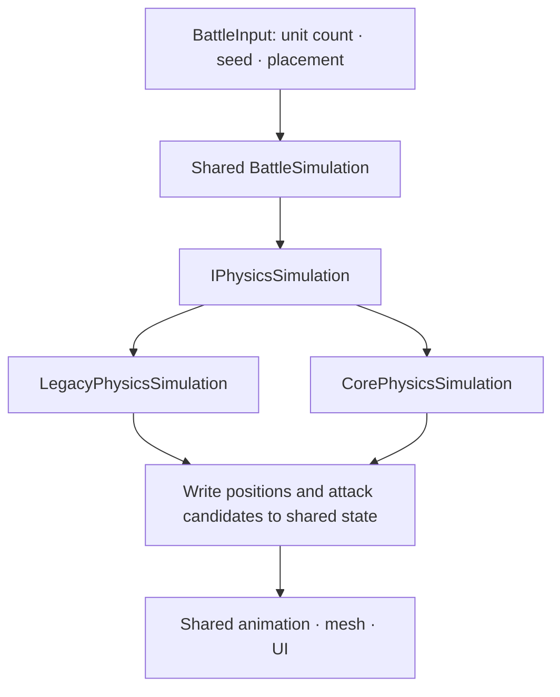

[English](README.md) · [日本語](README.ja.md) · [한국어](README.ko.md)

# Physics Comparison Lab


| Component | Version | Use |
|---|---|---|
| Unity | **6000.5.8f1 (Unity 6.5)** | Implementation, validation, and measurements in the Editor |
| PhysicsCore2D | **Built-in module 1.0.0** | Physics implementation using `Unity.U2D.Physics` |
| Legacy Physics2D | Built-in module 1.0.0 | Comparison implementation using `Rigidbody2D` and `Collider2D` |
| Rendering | Built-in Render Pipeline | Battlefield and character rendering |
| Unity Collections | 6.5.0 | Handling Core physics query results |
| Unity Test Framework | 1.7.0 | EditMode and PlayMode tests |

PhysicsCore2D's `1.0.0` is the version label for the built-in Unity module. The actual API used in this project is the one shipped with **Unity 6000.5.8f1**.
[Unity version](ProjectSettings/ProjectVersion.txt) · [Package versions](Packages/packages-lock.json)

---

## Why I tried it

PhysicsCore2D caught my attention because it lets you work directly with physics objects without tying them to GameObjects or components. I wanted to know how it differs from the familiar Rigidbody2D approach and whether it could help in a game where thousands of characters collide. Building a small battle seemed like a useful way to find out.

The API began as Low-level 2D Physics, based on Box2D v3, which Unity introduced on September 12, 2025 for the Unity 6.3 beta. On April 2, 2026, Unity announced the PhysicsCore2D name, a dedicated module, and the `Unity.U2D.Physics` namespace for the Unity 6.5 beta.
[Unity 6.3 introduction](https://discussions.unity.com/t/low-level-2d-physics-in-unity-6-3/1683247) · [Physics Core 2D announcement](https://discussions.unity.com/t/physics-core-2d-in-unity-6-5/1715178)

Using Unity 6000.5.8f1, I implemented the same battle with both systems: characters approach each other, fight, and reach an outcome. This let me compare how physics objects are managed and connected to their visuals, then measure how processing time changes as the armies grow.

## The experiment

Soldiers on the left and Orcs on the right move toward each other, push against one another, and attack at close range. One valid hit kills a unit. The entire battlefield, including both armies, runs on either legacy `UnityEngine.Physics2D` or the new `Unity.U2D.Physics`; switching engines changes the physics implementation for the whole battle.

Each army can contain 1–2,500 units, for a maximum of 5,000. The camera and ground adjust automatically to keep the battlefield in view as the armies grow.

> All timing results below were measured inside the Editor.


### Setup, legacy Physics2D, and the battle result

**Setup — 25 vs. 25**


**Legacy Physics2D — 250 vs. 250, paused at step 120**


**Core — 25 vs. 25, run at real-time 1× speed**

With seed 12345, the battle ended in a Soldier victory at step 280, about 4.67 seconds of simulation time, with 4 Soldiers and 0 Orcs remaining.


The live statistics on the right show the battle's current state. FPS and the last Step time left on a paused or finished screen do not represent performance during combat, so the comparison below uses repeated measurements instead.

## Implementation

The battle rules and visual code are shared, while the physics implementation responsible for movement and collisions can be swapped. Core and legacy Rigidbody2D/Collider2D belong to separate physics systems and do not collide with each other, so only one system runs the entire battle at a time.
[Unity 6000.5 introduction](https://docs.unity.com/en-us/engine/6000.5/manual/unity2d/2d-physics-api/get-started/introduction)

Battle state is stored in C# arrays without DOTS/ECS. The shared battle code calls `IPhysicsSimulation`, the selected engine advances the physics, and the resulting positions are passed to the shared visual code.



### Creating and releasing the physics world

The Core implementation starts by creating a `PhysicsWorld` directly, as shown in [CorePhysicsSimulation](Assets/PhysicsComparisonLab/Scripts/Physics/Core/CorePhysicsSimulation.cs). Gravity is set to 0, and simulation time is controlled by code. Owner keys for the created world and bodies are retained so their objects can be released when units die or the battle restarts. Unity's default world is left intact.

```csharp
var definition = PhysicsWorldDefinition.defaultDefinition;
definition.gravity = Vector2.zero;
definition.simulationType = PhysicsWorld.SimulationType.Script;
definition.drawOptions = PhysicsWorld.DrawOptions.Off;

_world = PhysicsWorld.Create(definition);
_key = _world.SetOwner(null);
```

Within this world, units use `Dynamic` bodies with circular shapes, while the four battlefield boundaries use `Static` bodies. Rotation is locked, and friction, restitution, and damping are set to 0. A radius of 0.12 and density of `1 / (πr²)` give each unit a mass of 1. The legacy implementation also uses a mass of 1, with Rigidbody2D and CircleCollider2D.

### Advancing both systems at the same interval

Both implementations advance by **1/60 of a second** per simulation step. The shared battle code sets movement velocities, advances the selected engine once, and reads back the result. The sequence is shared; the API calls differ:

| Operation | Legacy Physics2D | PhysicsCore2D |
|---|---|---|
| Apply velocity | Rigidbody2D velocity | PhysicsBody `linearVelocity` |
| Advance physics | `Physics2D.Simulate(seconds)` | `PhysicsWorld.Simulate(seconds)` |
| Read positions | Rigidbody2D position | PhysicsBody position |
| Query attack range | `Physics2D.OverlapCircle` | `PhysicsWorld.OverlapGeometry` |
| Death and shutdown | Disable physics, release GameObjects, restore the global simulation mode | Destroy owned bodies/worlds using their keys |

Because physics is advanced explicitly, automatic and manual simulation are configured not to overlap. The legacy implementation restores the global simulation mode on shutdown, and switching engines releases the previous physics objects before creating the next set.

Query cleanup also differs. Core releases the array returned with `Allocator.Temp` in a `finally` block. The legacy implementation uses a preallocated results buffer sized for all units and checks for overflow. The cost of creating and releasing Core's results array is included in the measurements.

### Shared battle rules and visuals

`BattleInput` supplies the initial positions, teams, IDs, and departure delays so both implementations start from the same conditions. The comparison uses seed 12345 and shared attack rules. If an attack starts at step A, **the hit is evaluated at A+18**, and **the next attack can begin at A+36**.

Units keep their target throughout an attack. At the hit step, the code queries the actual attack range and checks the distance again. Hit candidates from the same step are collected before deaths are applied together, allowing mutual kills. A battle without a winner ends after 1,800 steps, or 30 seconds of simulation time.

The resulting positions and animation frames are written into a shared mesh. There is no visual GameObject or Animator for each unit, although the legacy implementation still has its own physics GameObjects. Shared rules and visuals do not guarantee matching trajectories, hits, or winners: the engines handle contacts differently. Identical outcomes and deterministic replay across the two systems are not guaranteed.

## Functional validation

I checked that combat follows the rules, positions stay fixed while paused, and restarting cleans up the previous physics objects. The current code passed **25/25 EditMode tests and 5/5 PlayMode tests**, with actual engine behavior and controls checked within the scope below.
[Test results](Documentation/test-results.json) · [Validation notes](Documentation/Validation.en.md)

| Area | What was checked |
|---|---|
| Battle rules | Hits at A+18, repeat attacks at A+36, mutual kills, duplicate hits, fixed targets, time limit |
| Physics | Movement, contacts, attack-range queries, and body/world release through both APIs |
| Battle completion | 1:1, 1:2, 25:25, 100:100, and 250:250 battles run to completion with both systems |
| Session controls | Positions held while paused, exactly one step, restart, 10 switches, no duplicate event handlers |
| Input and UI | Invalid input rejected, unit additions and limits, 1×/2× speed, correct live counts on the right panel |
| Large-scale behavior | 1,500:1,500 with both systems for 120 steps: movement, hits, deaths, cleanup, and camera zoom-out |
| Maximum population | Core 2,500:2,500 regular combat for 120 steps; separately, repeated 720-step fixed-load runs with 5,000 units on both systems |

Validation at the maximum population used two different conditions. Regular combat with 5,000 units was checked in Core through step 120. The repeated measurements on both engines disabled deaths to keep the population fixed.


This scene started with 5,000 units and had 4,872 remaining at step 120. The displayed value of about 677 FPS was recorded **while paused** for the screenshot.

## Performance comparison

Once combat was working, I increased the unit counts and compared processing times. In regular battles, death timing and the remaining population differ between engines, changing the workload. The speed comparison therefore uses fixed-load runs with a constant population. Regular battle results are also available in the [full statistics](Documentation/Benchmarks/2026-10-28/tables.en.md) and [per-run CSV](Documentation/Benchmarks/2026-10-28/runs.csv).

In this scene, legacy Physics2D was faster at 25 vs. 25, while Core took less time in fixed-load runs of 100 vs. 100 and above. To see where the difference came from, I measured physics simulation separately from the full battle step. This was not a comparison of whole-frame FPS.

### Measurement conditions

| Item | Conditions |
|---|---|
| Hardware and OS | Windows 11, Ryzen 7 7800X3D, 16 logical processors, about 64 GB RAM, RTX 5070 Ti, Direct3D12 |
| Runtime | Unity 6000.5.8f1 Editor, Built-in, Mono, 1920×1080, VSync 0, uncapped frame rate, Profiler recording off |
| Shared input | seed 12345, dt 1/60 s, one physics system at a time, alternating Legacy→Core / Core→Legacy between repeats |
| Fixed load | 25/100/250/1,500/2,500 units per side, deaths disabled, 120 warmup steps followed by 600 measured steps |
| Regular battle | 25/100/250 units per side, measured from the first step until an outcome or step 1,800, deaths enabled |
| Visual updates | Measured both without visual updates and with shared mesh updates |
| Repeats | 5 per combination, **160 runs and 90,579 measured steps in total** |

UI and automatic camera updates were disabled, and up to 8 steps were processed per rendered frame without waiting for real time to elapse. The timings below cover a step's function call through its return, not the entire frame including GPU rendering. [Measurement details](Documentation/Benchmarks/README.en.md)

### Fixed load without visual updates

The first comparison excludes visual updates and measures physics simulation alongside the full battle step. The battle step includes physics, shared logic, attack queries, and position readback. All values are milliseconds (ms) per step; lower is better. Each run's median was calculated from 600 samples, and the table reports the median of those 5 run medians.

| Units | Legacy physics | Core physics | Legacy battle step | Core battle step |
|---:|---:|---:|---:|---:|
| 25 + 25 | 0.0359 | 0.0405 | 0.0466 | 0.0555 |
| 100 + 100 | 0.3015 | 0.1288 | 0.3548 | 0.1878 |
| 250 + 250 | 0.9702 | 0.2466 | 1.1102 | 0.3866 |
| 1,500 + 1,500 | 7.1841 | 0.8130 | 8.1589 | 1.5914 |
| 2,500 + 2,500 | 13.4339 | 1.2275 | 14.9513 | 2.5273 |


The graph uses a logarithmic vertical axis. Error bars show the minimum and maximum of the 5 run medians, not confidence intervals. At 5,000 units, Core's physics time was about **1/10.94** of the legacy implementation's, and its battle-step time without visuals was about **1/5.92**.

The same advantage did not hold for small battles. At 50 units, Core's physics calculation took **0.0046 ms**, or about 13%, longer. These ratios apply to the scene and settings shown here.

### Visual-update costs and slow steps

Even when physics becomes faster, the results still need to reach the screen. At the same maximum population, I included shared mesh updates and checked both typical processing times and slower steps.

| 2,500 + 2,500, including mesh updates | Legacy Physics2D | PhysicsCore2D |
|---|---:|---:|
| Physics p50 | 13.4643 ms | 1.2782 ms |
| Total p50 | 16.4155 ms | 4.0000 ms |
| Total p95 | 35.5988 ms | 21.2994 ms |

Here, p50 is the median and p95 is the value at the 95% point when samples are sorted from fastest to slowest. Each column reports the median of the corresponding statistics from 5 runs. Total processing time fell, but **Core's p95 was still 21.30 ms, above the 16.67 ms frame budget for 60 FPS.** Slow steps remained, so these results do not establish a stable 60 FPS.


This graph shows the mean time spent in each stage. Its aggregation differs from the medians in the table, but it shows that Core spent more time in shared logic, such as enemy searches, and mesh updates than in physics simulation itself.

### Scope of the results

The physics settings differed: Core used substeps 4 and workers 16; the legacy system used velocity iterations 8, position iterations 3, and Discrete collision detection. Solver accuracy and continuous-collision conditions were not matched. Fixed load prevented the population from falling, but it did not make trajectories or contact distributions identical. These results come from one seed and this particular layout.

The elapsed times include the influence of OS scheduling and the Editor environment. They are not the sum of CPU time across worker threads. Standalone Player performance, memory, GC, GPU, power consumption, and other platforms were not measured, and the on-screen counters were not used as evidence for those claims.

---

## What I took away

**Core's advantage was larger in the bigger battles tested here.** At a fixed load of 5,000 units, physics time fell from 13.43 ms with the legacy system to 1.23 ms with Core. That suggests it could help reduce physics costs in games where many units collide in dense groups. However, the legacy system was slightly faster at 50 units, and slow steps remained in Core; stable 60 FPS was not demonstrated.

I liked how easily physics objects could be separated from their visual GameObjects. Taking responsibility for world, body, and shape creation and cleanup was the trade-off, but it allowed that separation to be used in an actual battle.

Enemy searches and visual updates still cost time after switching to Core. Before adopting it in a game, it is worth checking whether physics is actually the bottleneck.

## Code map

| File | Responsibility |
|---|---|
| [BattleSettings](Assets/PhysicsComparisonLab/Scripts/Battle/BattleSettings.cs) / [BattleInput](Assets/PhysicsComparisonLab/Scripts/Battle/BattleInput.cs) | Shared settings and seed-based initial placement |
| [BattleSimulation](Assets/PhysicsComparisonLab/Scripts/Battle/BattleSimulation.cs) | Decisions → physics step → position readback → attack checks → simultaneous deaths |
| [IPhysicsSimulation](Assets/PhysicsComparisonLab/Scripts/Physics/IPhysicsSimulation.cs) | Shared interface for the two physics implementations |
| [LegacyPhysicsSimulation](Assets/PhysicsComparisonLab/Scripts/Physics/Legacy/LegacyPhysicsSimulation.cs) | Creation, simulation, queries, and cleanup of legacy components |
| [CorePhysicsSimulation](Assets/PhysicsComparisonLab/Scripts/Physics/Core/CorePhysicsSimulation.cs) | World/body/shape creation, owner keys, query-result cleanup |
| [BattleTargetIndex](Assets/PhysicsComparisonLab/Scripts/Battle/BattleTargetIndex.cs) | Nearest-enemy search and tie-breaking for equidistant targets |
| [BattleWorldView](Assets/PhysicsComparisonLab/Scripts/Presentation/BattleWorldView.cs) | Writes positions and animation frames to the shared mesh |
| [BattleComparisonEntryPoint](Assets/PhysicsComparisonLab/Scripts/Presentation/BattleComparisonEntryPoint.cs) | Session control and resource cleanup |
| [Tests](Assets/PhysicsComparisonLab/Tests/) | Shared rules and tests using the actual scene |

## Asset credits and terms

The following free assets were used:

| Use | Creator and asset | Content used |
|---|---|---|
| Characters | **Zerie** — [Tiny RPG Character Asset Pack](https://zerie.itch.io/tiny-rpg-character-asset-pack) | Free Soldier and Orc idle, movement, attack, and death animations |
| Terrain, decorations, UI | **Pixel Frog** — [Tiny Swords](https://pixelfrog-assets.itch.io/tiny-swords) | Grass tiles, trees, bushes, rocks, buttons, and paper panels from the free pack |

Both creators' terms permit use and modification in personal and commercial games, but prohibit redistribution of the original or modified asset files. **The asset files are therefore not included in this repository.** (Distribution-page terms checked on 2026-10-28.)

The performance graphs were created by **hakrimryu**. Please retain the attribution when citing them.

## Data and references

- [Measurement methodology](Documentation/Benchmarks/README.en.md) · [Raw CSV and recorded settings](Documentation/Benchmarks/2026-10-28/) · [Validation notes](Documentation/Validation.en.md)
- [Analysis and graph code](Documentation/Benchmarks/analyze.py) · [Editor measurement code](Documentation/Benchmarks/EditorComparison.cs)
- [Screenshot states and hashes](Documentation/screenshots.json) · [Source SHA256 at measurement time](Documentation/Benchmarks/2026-10-28/source-sha256.json)
- [Unity 6.5 Physics Core 2D documentation](https://docs.unity.com/en-us/engine/6000.5/manual/unity2d/2d-physics-api/get-started/introduction)
